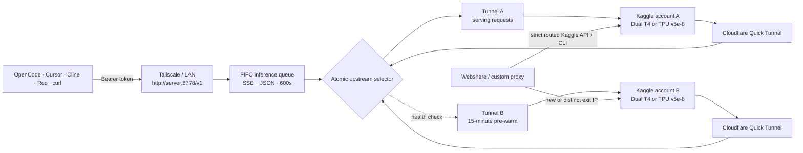

<div align="center">

# ⚡ GPU Hub — Kaggle Orchestrator

### Turn a pool of free Kaggle GPU and TPU sessions into one permanent OpenAI and Anthropic API.

[](LICENSE)
[](https://www.python.org/)
[](https://fastapi.tiangolo.com/)
[](https://www.kaggle.com/)
[](https://tailscale.com/)
[](#zero-downtime-lifecycle)
[](#webshare-zero-leak-proxy-shield)

**One stable URL. Multiple free accelerators. Automatic weekly rotation.**

</div>

GPU Hub launches model-serving kernels on Kaggle, discovers their temporary Cloudflare tunnels, and hides those changing URLs behind a permanent bearer-authenticated endpoint on your own server. OpenCode, Cursor, Cline, Roo Code, SillyTavern, Claude-compatible tools, and ordinary OpenAI SDKs keep using the same address while GPU Hub verifies keys, tracks quota, pre-warms the next account, drains in-flight requests, and swaps upstreams.

> This project automates infrastructure you control. Follow Kaggle, Webshare, Cloudflare, model, and network-provider terms. Only add accounts and proxies you are authorized to use.

## Why developers use it

- **Permanent agent endpoint:** `/v1/chat/completions`, `/v1/completions`, `/v1/models`, `/v1/messages`, and `/v1/messages/count_tokens` on port `8778`.
- **OpenAI and Anthropic compatibility:** bearer auth, JSON responses, SSE streaming, tool-call translation, and 600-second generation timeouts.
- **Multi-account lifecycle:** immediate key verification, ordered rotation, rolling seven-day GPU/TPU ledgers, manual resets, boot-time history, and a launch circuit breaker.
- **Zero-downtime hot swap:** Tunnel A serves while Tunnel B starts 15 minutes before a session or weekly limit. A health check atomically moves new traffic to B; A drains before shutdown.
- **Safe cold starts:** incoming inference waits in a FIFO queue while Auto-Wake launches an accelerator. The UI and response headers expose the warm-up ETA.
- **Webshare proxy shield:** per-account exit-IP pinning, strict proxy preflight, single-IP rotation, and no direct fallback when a protected route fails.
- **Mobile-first control plane:** live launch phases, smooth timers, key-pool actions, custom proxy drawers, custom GGUF models, quota meters, and endpoint copy buttons.
- **No native mobile selectors:** every dropdown is a themed custom component; Webshare and per-account routes use backdrop-blur modals instead of browser sheets, prompts, or alerts.
- **TPU allocation self-healing:** TPU launches delete stale kernel slugs first. CPU-only `no-tpu` allocations are recreated on revisioned slugs up to four times without cooling down the account or tripping the key-pool circuit breaker.
- **Local compatibility bridge:** the same API is also available on `127.0.0.1:8776`.

## Architecture



Kaggle credentials only contact Kaggle through their selected network route. Inference traffic uses the already-established Cloudflare tunnel and does not touch Kaggle APIs.

## Hardware and model matrix

| Profile | Free accelerator | Memory | Model shape | Quantization | Context | Typical output speed* |
|---|---|---:|---|---|---:|---:|
| Qwen3.8-Flash-Next preview | TPU v5e-8 | 128 GB HBM | 180B footprint, 6B active | External sub-4-bit recipe required | 262,144 | Recipe-dependent |
| GLM-5.3-Flash | TPU v5e-8 | 128 GB HBM | 320B MoE, 18B active | 3-bit experts / int8 | 262,144 | ~165 tok/s |
| Qwen3.8-27B | TPU v5e-8 | 128 GB HBM | 27B dense | BF16 + MTP | 262,144 | ~130 tok/s single, ~540 tok/s at 8 streams |
| CyberTiel-Coder-35B-A3B | Dual Tesla T4 | 32 GB GDDR6 | 35B MoE, ~3.4B active | UD-Q4_K_XL | 262,144 | 40–55 tok/s |
| Qwen3.8-27B-Instruct | Dual Tesla T4 | 32 GB GDDR6 | 27B dense | Q4_K_M | 262,144 | 28–35 tok/s |
| Qwen2.5-Coder-32B | Dual Tesla T4 | 32 GB GDDR6 | 32.5B dense | Q4_K_M | 131,072 | 20–25 tok/s |
| Llama-3.3-70B | Dual Tesla T4 | 32 GB GDDR6 | 70.6B dense | IQ3_M | 65,536 | 8–12 tok/s |

\*Measured speed depends on Kaggle allocation, prompt length, cache state, and concurrency. The GLM and Qwen TPU recipes are derived from the MIT-licensed [`ARahim3/kaggle-tpu-lab`](https://github.com/ARahim3/kaggle-tpu-lab) workflows vendored under `tpu_lab/`.

A 262,144-token context is eight times a 32,768-token training window. GPU profiles use YaRN plus quantized KV caches; TPU profiles use their recipe-native long-context configuration.

## Five-minute friend setup

### 1. Clone and install

```bash
git clone https://github.com/Naruto859/GPU-Hub-Kaggle-Orchestrator.git
cd GPU-Hub-Kaggle-Orchestrator
python3 -m venv .venv
. .venv/bin/activate
pip install -r requirements.txt
cp .env.example .env
```

Python 3.10 or newer, `git`, `curl`, and `systemd` are recommended. GPU Hub itself can run on a small VPS; the model runs on Kaggle.

### 2. Install the service

Edit paths and the service user if you cloned somewhere other than `/opt/gpu-hub`:

```bash
sudo mkdir -p /opt/gpu-hub
sudo rsync -a --delete ./ /opt/gpu-hub/
sudo cp deploy/uncensored-manager.service /etc/systemd/system/uncensored-manager.service
sudo systemctl daemon-reload
sudo systemctl enable --now uncensored-manager.service
curl http://127.0.0.1:8778/api/status
```

For a quick foreground run:

```bash
python app.py
```

### 3. Connect Tailscale

Install Tailscale on the server and each trusted client, then open:

```text
http://<tailscale-ip>:8778
```

The dashboard shows the exact base URL, full chat URL, and client bearer key. The recommended base URL is:

```text
http://<tailscale-ip>:8778/v1
```

### 4. Add a Kaggle personal access token

Create a token in **Kaggle → Settings → API**, paste only the token into the key field, and press **Add Account to Queue**. The username field is optional: GPU Hub introspects the token, falls back to account-scoped Kaggle CLI/API queries, verifies it, and marks it **VERIFIED · READY**.

Add friends’ authorized tokens one per line in the bulk drawer. GPU Hub rotates accounts sequentially and resets locally exhausted ledgers when each rolling seven-day window expires.

### 5. Configure switching and the network shield

Optional but recommended for a multi-account pool:

- Use **Auto-Switching & Network Shield** to turn 24/7 key rotation on or off and choose Server Direct, Webshare, or a custom proxy as the default route.
- Press **Connect / Change Webshare Key** to open the secure token modal, then **Verify & Connect**.
- Leave **Auto-Refresh IP on account switch & 15-min pre-warm** enabled.
- On each account card, **Custom Proxy / IP** opens a route modal with Use Default Route, Webshare, Server Direct, and custom HTTP/SOCKS5 choices.

Then choose a model and press **Launch Model**. Large TPU recipes usually need 6–15 minutes; Dual T4 profiles usually need 4–5 minutes.

## Client configuration

### OpenAI SDK and OpenCode-compatible tools

```bash
export OPENAI_BASE_URL="http://<tailscale-ip>:8778/v1"
export OPENAI_API_KEY="<client-key-from-dashboard>"
```

```bash
curl "$OPENAI_BASE_URL/chat/completions" \
  -H "Authorization: Bearer $OPENAI_API_KEY" \
  -H "Content-Type: application/json" \
  -d '{
    "model": "cybertiel-coder-35b-a3b",
    "messages": [{"role": "user", "content": "Explain this repository."}],
    "stream": false
  }'
```

### Anthropic and Claude-compatible tools

```bash
export ANTHROPIC_BASE_URL="http://<tailscale-ip>:8778"
export ANTHROPIC_AUTH_TOKEN="<client-key-from-dashboard>"
```

Use `/v1/messages` as the messages endpoint. GPU Hub forwards native Anthropic requests when the upstream supports them and translates compatible requests when needed.

### Cursor, Cline, Roo Code, and SillyTavern

Choose an OpenAI-compatible provider and enter:

| Setting | Value |
|---|---|
| Base URL | `http://<tailscale-ip>:8778/v1` |
| API key | Client key shown in GPU Hub |
| Model | A model ID from `/v1/models` |

## Zero-downtime lifecycle

1. The active account serves through Tunnel A.
2. At 8h45m of a 9-hour session, or with 15 minutes of weekly quota remaining, GPU Hub chooses the next verified account.
3. Tunnel B starts in the background while all existing requests stay on A.
4. GPU Hub waits for B’s `/v1/models` health check.
5. New requests switch atomically to B. Requests already using A finish there.
6. A drains and its Kaggle session stops.
7. If B fails, the circuit breaker records the failure, rotates safely, and backs off instead of hammering Kaggle.

TPU recipes use an additional recovery path. GPU Hub deletes any stale TPU kernel before launch so Kaggle must create a new VM. If JAX reports a CPU-only allocation, GPU Hub keeps the same timer and account, deletes the failed slug, increments it to `-r1` through `-r4`, waits ten seconds, and re-pushes. These allocation glitches never count as invalid keys, account cooldowns, or circuit-breaker failures.

With one key, GPU Hub never opens a duplicate session on the same account. It stops at the session boundary, waits a 20-second safety buffer, and restarts only when weekly quota remains.

## Webshare zero-leak proxy shield

Protected routes use these invariants:

- Every Kaggle CLI and HTTP request carries `HTTP_PROXY`, `HTTPS_PROXY`, and `ALL_PROXY`.
- A proxy exit-IP check must pass before a Kaggle command starts.
- Failure produces `PROXY_ERROR`; there is no direct VPS fallback.
- With multiple Webshare proxies, accounts are pinned to distinct verified exit IPs.
- With one rotatable proxy, GPU Hub freezes Account A’s Kaggle status polling, refreshes the IP, waits five seconds, verifies the address changed, and only then authenticates Account B.
- Tunnel A remains monitored through its Cloudflare `/v1/models` endpoint during the isolation window.
- A local monthly ledger displays refreshes used out of 250 and resets at the UTC month boundary.

## Dashboard controls

Each account has a compact six-button grid:

| Row | Left | Right |
|---|---|---|
| 1 | Set Active | Verify Key |
| 2 | Test & Measure Boot | Reset Weekly Quota |
| 3 | Custom Proxy / IP | Delete |

The lifecycle card shows pushing, provisioning, model loading, tunnel opening, elapsed time, estimated remaining time, and the 15-minute maximum ETA. You can also add a Hugging Face GGUF model through the custom-model drawer; private runtime definitions remain untracked.

The standalone network card contains the persisted 24/7 rotation toggle, default route selector, Webshare status, IP refresh counter, connect/change modal, and disconnect-to-direct action. The Kaggle key card contains only credential entry and the key queue.

## Configuration and state

Runtime files are created beside the application with mode `0600`. They are ignored by Git:

- Kaggle account pool and usage ledger
- Client bearer secret
- Webshare token and refresh ledger
- Current controller state
- Custom model registry
- Logs, caches, downloaded outputs, and local environment files

Copy the provided `*.example.json` files only when you need a starting template. Never commit populated runtime files.

## API surface

| Route | Purpose |
|---|---|
| `GET /api/status` | Lifecycle, warm-up, model, account, queue, and Webshare status |
| `GET/POST /api/settings` | Persist automatic rotation and the default network route |
| `POST /api/kaggle/launch` | Launch or Auto-Wake the selected model |
| `POST /api/kernel/stop` | Stop active, warming, and test sessions |
| `POST /api/lifecycle/prewarm` | Manually start Tunnel B |
| `GET/POST /api/webshare/*` | Connect, inspect, refresh, and configure rotation |
| `GET /v1/models` | OpenAI-compatible models |
| `POST /v1/chat/completions` | OpenAI chat, JSON or SSE |
| `POST /v1/completions` | OpenAI text completions |
| `POST /v1/messages` | Anthropic messages |

## Development and verification

```bash
python3 -m py_compile app.py account_pool.py kaggle_manager.py proxy_service.py models_registry.py webshare_manager.py
python3 -m unittest discover -s tests -v
```

Before publishing, scan the staged tree and verify runtime JSON files are absent. The repository intentionally includes sanitized example files rather than working credentials.

## Credits

- [`ARahim3/kaggle-tpu-lab`](https://github.com/ARahim3/kaggle-tpu-lab) for the open TPU serving recipes.
- Kaggle for hosted accelerators, Cloudflare for Quick Tunnels, Tailscale for private networking, and Webshare for optional proxy routing.
- llama.cpp, FastAPI, httpx, and the model authors listed in `models_registry.py`.

## License

MIT. See [LICENSE](LICENSE).
